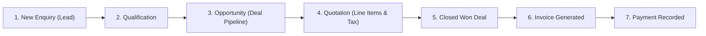
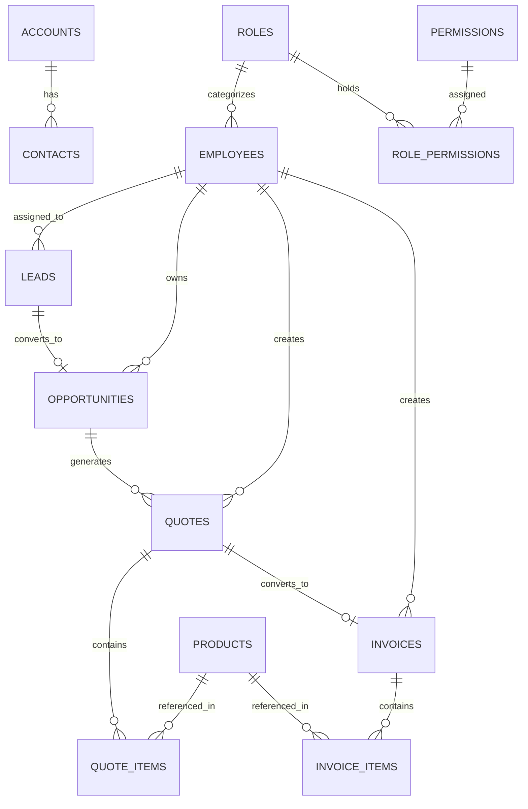

# CRM 360 Enterprise — Interviewer Guide

This document explains the project in a clear, convincing way for technical interviewers, hiring managers, and clients. It covers the business purpose, technical architecture, modules, workflow, and sample interview answers.

---

## 1. Project Overview

CRM 360 Enterprise is a full-stack customer relationship management system built for businesses that need to manage the complete sales lifecycle from lead generation to payment collection.

It brings together multiple business functions into one platform:
- Sales teams for lead tracking and opportunity management
- Field executives for visit tracking and location updates
- Finance teams for quotation and invoice workflows
- Admins for roles, employees, permissions, and audit visibility

The core idea is simple: reduce manual coordination, improve visibility across the sales process, and centralize customer, product, billing, and activity data.

---

## 2. Business Problem Solved

Most organizations struggle with disconnected systems for:
- customer information
- sales activities
- quote and invoice status
- communication and follow-ups
- field force movement tracking
- document and approval records

CRM 360 solves that by giving the organization one integrated workflow:

Lead -> Qualification -> Opportunity -> Quotation -> Invoice -> Payment

This creates a single source of truth for the sales and billing lifecycle.

---

## 3. 30-Second Elevator Pitch

> "CRM 360 Enterprise is a full-stack CRM platform designed to manage the end-to-end lead-to-cash process for a business. It combines sales pipeline tracking, quotation generation, invoice lifecycle management, document control, and real-time field force GPS tracking in one system. The application is built using FastAPI, SQLAlchemy, Microsoft SQL Server, and React, with role-based access control, auto-generated billing workflows, and a dashboard-focused user experience."

---

## 4. High-Level Architecture

```text
Browser / Frontend
  React + Vite + CSS + Leaflet + WebSockets
            |
            v
REST API + WebSocket Layer
  Python FastAPI
  JWT auth, RBAC, email, file upload, geo updates
            |
            v
Business / Data Layer
  SQLAlchemy ORM
  Microsoft SQL Server
  Alembic migrations
```

### Technology Stack

Frontend
- React 18
- Vite
- JavaScript / JSX
- CSS styling and responsive dashboard UI
- Leaflet + OpenStreetMap for geo maps

Backend
- Python
- FastAPI
- SQLAlchemy 2.0
- Pydantic
- JWT-based authentication
- WebSocket support for live tracking

Database
- Microsoft SQL Server
- Normalized relational schema
- Migration support with Alembic

---

## 5. Core Modules and Features

### 5.1 Authentication and Authorization
- Secure employee login using email or employee code
- Password hashing using bcrypt
- JWT-based session management
- Dynamic role-based access control
- Granular permission checks for create, view, edit, and delete actions

Why it matters:
- Different users see different features based on responsibility
- Admins can manage access without changing code
- Security is enforced at the API layer

### 5.2 Leads and Qualification
- Capture new customer enquiries
- Track source, budget, requirements, and status
- Qualify or reject the lead
- Convert qualified leads into opportunities

Why it matters:
- Sales teams can move from raw inquiry to structured pipeline quickly
- Qualification becomes consistent and auditable

### 5.3 Opportunity Pipeline
- Manage sales opportunities across stages
- Track expected revenue and probability
- Monitor win/loss movement
- Convert won deals into customer/account records

Why it matters:
- Sales managers can forecast revenue more accurately
- The system supports pipeline visibility at management level

### 5.4 Products and Pricebook
- Maintain product catalog with SKU, price, tax, and unit details
- Support quote line items and invoice line items from the same catalog
- Centralize pricing rules

Why it matters:
- Reduces pricing inconsistency
- Improves quotation accuracy and transparency

### 5.5 Quotations and Estimates
- Build quotes with multiple items and quantities
- Auto-calculate subtotal, discount, tax, and total
- Generate estimate/proposal records linked to the opportunity
- Convert accepted quotes into invoices

Why it matters:
- Sales work is accelerated
- Billing logic remains consistent with approved commercial terms

### 5.6 Invoices and Billing
- Generate invoices from accepted quotes
- Track status such as Draft, Issued, Partially Paid, and Paid
- Record payments and balances
- Maintain invoice history

Why it matters:
- Finance has a clear, trackable billing workflow
- Cash collection and receivables can be monitored more effectively

### 5.7 Accounts and Contacts
- Maintain customer accounts and organizational details
- Associate multiple contacts with accounts
- Support relationship mapping across clients and sales activity

Why it matters:
- Better customer context for the sales and support teams
- Stronger account-level reporting

### 5.8 Document Vault
- Store commercial documents, contracts, and attachments
- Link files to leads, companies, or invoices
- Upload and retrieve documents through the application

Why it matters:
- Keeps critical documents in one place
- Improves operational traceability

### 5.9 Field Force Geo Tracking
- Capture GPS check-ins/check-outs
- Track visit history with coordinates and remarks
- Broadcast live location updates over WebSockets
- Visualize movement on an OpenStreetMap-based dashboard

Why it matters:
- Useful for sales teams, collection teams, service visits, and field supervision
- Enables real-time monitoring without polling the server repeatedly

### 5.10 Analytics and Reports
- Executive dashboard for sales performance
- KPI-style charts and summary data
- Visual analytics for lead distribution, opportunities, and revenue trends

Why it matters:
- Managers can assess performance quickly
- Data is no longer buried in spreadsheets or isolated tables

---

## 6. Business Workflow: Lead-to-Cash

The project is designed around a realistic sales flow:

1. A new enquiry arrives from a lead source
2. The sales team qualifies the lead
3. A qualified lead becomes an opportunity
4. A quote is generated with products and pricing
5. The quote is approved or converted to invoice
6. Payment is tracked against the invoice
7. Documents and activities are attached for audit and follow-up

This workflow is highly relevant in real enterprise environments because it mirrors how sales and finance teams actually operate.

---

## 7. Database Design Overview

The backend uses a normalized relational database in Microsoft SQL Server.

Key relationships include:
- Employees are linked to leads, opportunities, quotes, and invoices
- Accounts have multiple contacts
- Opportunities generate quotes
- Quotes generate invoices
- Products are reused in quote and invoice line items
- Roles are linked to permissions
- Audit logs store actions, updates, and entity changes

This relational structure keeps the data consistent and allows strong referential integrity.

---

## 8. Why This Project Is Strong for an Interview

This project demonstrates several important software engineering skills:

- Full-stack application development
- API design with FastAPI
- Database modeling and SQL schema planning
- Role-based access control
- Business process modeling
- Real-time communication with WebSockets
- Frontend application state and dashboard UI
- Deployment with Docker and environment configuration
- Testing and project structure discipline

It is not only a demo app; it reflects how enterprise systems are built in real-world business workflows.

---

## 9. Sample Interview Answers

### Q1: Why did you choose FastAPI?

> Because FastAPI is fast, modern, and well-suited for building structured APIs with clear validation and documentation. It gave us clean endpoints, dependency injection for authentication, and better developer efficiency compared to manually wiring everything from scratch. It also integrates well with SQLAlchemy and Pydantic.

### Q2: What is the most important part of the project?

> The most important part is the end-to-end business workflow: lead qualification, opportunity pipeline, quoting, invoicing, and billing. The project is valuable because it mirrors a real business process rather than just displaying static data.

### Q3: How did you manage user permissions?

> We implemented dynamic role-based access control. Roles are separate from permissions, and permissions are checked at protected API routes. A user gets access only to actions and modules permitted by their assigned role.

### Q4: How did you handle real-time features?

> We used WebSockets for live field tracking. When a field user sends position updates, those updates are broadcast to connected clients so the dashboard can reflect changes in near real time.

### Q5: What would you improve next?

> I would add stronger reporting filters, export features, better audit search, notification workflows, and deeper automation such as approval chains or scheduled invoice reminders.

---

## 10. Demo Walkthrough for Interviewers

If asked to show the system live, the best flow is:

1. Log in with admin credentials
2. Open Dashboard and explain sales KPIs
3. Navigate to Leads and show lead intake workflow
4. Qualify a lead into an opportunity
5. Open quotation builder and show line-item calculations
6. Convert the quote to invoice
7. Show invoice status and payment tracking
8. Open Geo Tracking to explain live field monitoring
9. Explain role-based access and admin controls

This gives the interviewer a complete business story instead of just a UI demo.

---

## 11. Quick Run Instructions

### Backend
```bash
cd backend
python -m venv venv
venv\Scripts\activate
pip install -r requirements.txt
uvicorn app.main:app --reload --port 8000
```

### Frontend
```bash
cd frontend
npm install
npm run dev
```

### Docker
```bash
docker-compose up --build
```

Access points:
- Frontend: http://localhost:5173
- API Docs: http://localhost:8000/docs

---

## 12. Closing Statement for an Interview

> This project demonstrates my ability to design and implement a complete business application using modern backend and frontend technologies. It combines product thinking, system design, database modeling, secure authentication, workflow automation, and visualization into one coherent solution that reflects real enterprise operations.

---

## 2. 🏗️ High-Level Technical Architecture

```
┌────────────────────────────────────────────────────────────────────────┐
│                          CLIENT LAYER (Browser)                        │
│   React 18 + Vite • Vanilla CSS • Leaflet (OpenStreetMap) • WebSockets  │
└───────────────────────────────────┬────────────────────────────────────┘
                                    │ HTTP REST (JSON) + WS (/ws/geo)
                                    ▼
┌────────────────────────────────────────────────────────────────────────┐
│                        API GATEWAY & BACKEND LAYER                     │
│                        Python FastAPI Framework                        │
│  ────────────────────────────────────────────────────────────────────  │
│  • JWT Authentication (OAuth2 Bearer, Bcrypt)                          │
│  • Dynamic Role-Based Access Control (RBAC Permission Matrix)          │
│  • Real-time WebSocket Connection Manager (/ws/geo)                    │
│  • Automated Email Dispatch Service (SMTP)                             │
│  • File Upload & Streaming Engine (FastAPI UploadFile)                 │
└───────────────────────────────────┬────────────────────────────────────┘
                                    │ SQLAlchemy 2.0 ORM (PyODBC Driver)
                                    ▼
┌────────────────────────────────────────────────────────────────────────┐
│                          DATABASE LAYER                                │
│                   Microsoft SQL Server 2022 (T-SQL)                    │
│  ────────────────────────────────────────────────────────────────────  │
│  • 16 Normalized Relational Tables with Foreign Key Constraints        │
│  • Version-Controlled Migrations via Alembic                           │
└────────────────────────────────────────────────────────────────────────┘
```

---

## 3. 💼 The Core Business Workflow: "The Lead-to-Cash Cycle"

When an interviewer asks, *"How does a business use this application?"*, explain the **Lead-to-Cash** pipeline:



1. **Intake (Leads):** Marketing captures leads (Website, Referral, Exhibition).
2. **Qualification:** Sales reps qualify the budget, timeline, and requirements. Disqualified leads require reason logging.
3. **Deal Creation (Pipeline):** Qualifying a lead automatically converts it into a sales **Opportunity** across pipeline stages (`Opportunity` ➔ `Proposal` ➔ `Negotiation` ➔ `Won` / `Lost`).
4. **Quotation Generation (Quotes):** Sales reps select items from the **Product Catalog**. Subtotals, standard 18% taxes, and discounts auto-calculate into a formal proposal with PDF/print capabilities.
5. **Conversion (One-Click Invoicing):** When a quote is accepted, a single click converts it into an active **Invoice** with a payment due date.
6. **Payment & Reconciliation (Billing):** Finance records payments against invoices (`Paid`, `Partially Paid`, `Overdue`).
7. **Document Archival (Vault):** Contracts, signed proposals, and client NDAs are uploaded to the Document Vault and linked to the account.

---

## 4. 🧩 Complete Modules Walkthrough

| Module | What it Does | Technical Highlights |
| :--- | :--- | :--- |
| **Authentication & RBAC** | JWT login via email or employee code; dynamic permissions per role (`view`, `create`, `edit`, `delete`). | Password hashing with `bcrypt`; permissions validated in FastAPI dependency injections (`deps.py`). |
| **Leads & Qualification** | Tracks prospects, budgets, and lead sources. | One-click qualification automatically instantiates linked `Opportunity` records. |
| **Opportunity Pipeline** | Sales deal tracker with stages, win probabilities, and expected deal values. | Dynamic probability adjustment per stage; automatic creation of Customer Accounts on "Won" deals. |
| **Products & Pricebook** | Central catalog of items, SKUs, unit rates, tax configurations, and units of measure (UOM). | Server-side pagination (`skip`, `limit`, `search`). |
| **Quotations & Estimates** | Multi-item proposal builder linked to products and opportunities. | Instant item calculation; printable proposal preview; one-click convert to invoice. |
| **Invoices & Billing** | Invoice lifecycle management with balance due tracking. | Partial and full payment tracking; status transition (`Draft` ➔ `Issued` ➔ `Partially Paid` ➔ `Paid`). |
| **Document Vault** | Central attachment storage for contracts, proposals, and images. | Multi-part file streaming using FastAPI `UploadFile`, disk storage in `backend/uploads/`, entity tagging. |
| **Field Geo-Tracking** | Real-time field force GPS check-in/out and visit logging. | Browser Geolocation API + Leaflet / OpenStreetMap (100% free tiles) + **Real-time WebSockets** (`/ws/geo`). |
| **Accounts & Contacts** | Corporate customer accounts and linked organizational contacts. | Foreign key linkage (`accounts.id ➔ contacts.account_id`); primary contact identification. |
| **Tasks & Meetings** | Team productivity, agendas, meeting scheduling, and task prioritization. | Due date filtering; assignment to sales reps (`assigned_to_id`). |
| **Visual Analytics** | Executive dashboard and sales performance metrics. | Custom vector SVG charts (`BarChart`, `DonutChart`) without bloated 3rd-party dependencies; CSV export. |
| **Email Service** | Automated notification dispatch for proposals and billing. | Standard Python `smtplib` and `email.mime` with graceful simulation when offline. |

---

## 5. 📂 Project Folder Structure Explained

```
c:/Rana/CRM/
├── docker-compose.yml              # One-command orchestration (SQL Server + FastAPI + React)
├── README.md                       # Setup and run instructions
├── backend/
│   ├── Dockerfile                  # Python 3.11 + MS ODBC Driver 17 container
│   ├── requirements.txt            # Dependencies (FastAPI, SQLAlchemy, PyODBC, Pytest, WebSockets)
│   ├── alembic.ini                 # Database migrations configuration
│   ├── alembic/                    # Migration scripts and version history
│   │   ├── env.py                  # SQLAlchemy metadata linkage
│   │   └── versions/               # Schema revisions (001_initial_schema.py)
│   ├── app/
│   │   ├── main.py                 # FastAPI application root & router mounts
│   │   ├── seed.py                 # Auto-seeding script (Admin user, roles, demo products)
│   │   ├── core/
│   │   │   ├── config.py           # Pydantic BaseSettings (.env reader)
│   │   │   ├── security.py         # JWT creation, token verification, bcrypt hashing
│   │   │   ├── email.py            # SMTP email dispatch engine
│   │   │   └── db/
│   │   │       ├── base.py         # SQLAlchemy Base declaration
│   │   │       └── session.py      # Database Engine & SessionLocal generator
│   │   ├── models/                 # SQLAlchemy ORM entities (16 models)
│   │   │   ├── lead.py, opportunity.py, quote.py, invoice.py, product.py
│   │   │   ├── account.py, contact.py, employee.py, role.py, document.py ...
│   │   ├── schemas/                # Pydantic V2 Request & Response validation models
│   │   └── api/
│   │       ├── deps.py             # Dependency injection (get_current_user, RBAC checks)
│   │       └── routes/             # REST endpoints (leads, quotes, invoices, geo, ws ...)
│   └── tests/                      # Automated Pytest suite (conftest.py, test_quotes.py ...)
│
└── frontend/
    ├── Dockerfile                  # Node 18 Alpine container
    ├── package.json                # React 18, Vite, Axios, Lucide-React
    ├── index.html                  # HTML entry point with Google Fonts & Leaflet CDN
    └── src/
        ├── main.jsx                # React DOM render entry
        ├── App.jsx                 # Top nav bar, session management, dynamic tabs
        ├── index.css               # Design tokens, color palette, dark mode styles
        ├── api/
        │   └── client.js           # Axios instance with auto JWT Bearer token injection
        ├── components/
        │   ├── Toast.jsx           # Global notification toast context & alerts
        │   └── Charts.jsx          # Vector SVG BarChart & DonutChart components
        └── pages/                  # 16 Feature screens (Dashboard, Quotes, Invoices ...)
```

---

## 6. 🗄️ Database Design & Entity Relationships

The database is built on **Microsoft SQL Server** with normalized schemas:



- **Referential Integrity:** Cascading deletes on line items (`QuoteItem` deleted if parent `Quote` is removed).
- **Auditability:** `AuditLog` table stores user actions, IP addresses, entity mutations, and timestamps.

---

## 7. 🎤 Key Interview Questions & High-Scoring Answers

### Q1: "Why did you choose FastAPI instead of Django or Flask?"
> **Answer:** *"FastAPI provides asynchronous concurrency (ASGI), high performance comparable to Node/Go, automatic interactive OpenAPI (Swagger) documentation, and native Pydantic V2 validation. Unlike Django, which is heavily coupled to its own ORM and template engine, FastAPI allowed us to pair with SQLAlchemy 2.0 and Microsoft SQL Server seamlessly while maintaining clean separation of concerns."*

### Q2: "How did you implement Dynamic Role-Based Access Control (RBAC)?"
> **Answer:** *"We decoupled roles from hardcoded permissions using three models: `Role`, `Permission`, and `RolePermission`. Each permission has a granular code like `leads:create` or `opportunities:edit`. When a user logs in, their permissions and scopes are encoded with their JWT token. On protected endpoints, FastAPI dependencies verify that the employee’s active role possesses the required permission before executing the route."*

### Q3: "How does the Real-Time Field Force Geo-Tracking work?"
> **Answer:** *"It has two complementary components:
> 1. **Persistent History:** Field executives perform location check-ins using the HTML5 Geolocation API, which logs GPS coordinates, reverse-geocoded addresses, and visit remarks to MS SQL Server.
> 2. **Real-Time Live Updates:** We implemented a WebSocket endpoint (`/ws/geo`) with a Python `ConnectionManager`. When any field agent sends a location update, it is instantly broadcast to all open dashboard instances, updating Leaflet OpenStreetMap markers in real time without polling."*

### Q4: "How do you handle database migrations in production?"
> **Answer:** *"While initial bootstrapping can use SQLAlchemy's `create_all()`, production systems require version-controlled migrations. We configured **Alembic** (`alembic.ini` and `alembic/env.py`). Schema mutations are tracked as revision files in `alembic/versions/` and applied using `alembic upgrade head`, ensuring zero data loss and automated CI/CD deployment compatibility."*

### Q5: "How is data consistency handled between Quotations and Invoices?"
> **Answer:** *"When a quotation is approved, we have an atomic workflow endpoint (`/quotes/{id}/convert-to-invoice`). The system marks the quote as 'Accepted', generates a linked `Invoice` with identical line items and tax calculations, attaches foreign keys, and calculates the balance due. This eliminates manual re-entry errors and guarantees consistency across commercial proposals and accounting."*

---

## 8. 💻 Quick Commands to Run the Demo for an Interviewer

### Option 1: Local Terminal (2 Terminals)
```powershell
# Terminal 1: Backend
cd backend
.\venv\Scripts\python.exe -m uvicorn app.main:app --reload --port 8000

# Terminal 2: Frontend
cd frontend
npm run dev
```

### Option 2: Docker Multi-Container
```bash
docker-compose up --build
```

- **Frontend Application:** `http://localhost:5173`
- **Interactive Swagger API Docs:** `http://localhost:8000/docs`
- **Demo Admin Credentials:** `admin@crm360.com` / `Admin@123`
